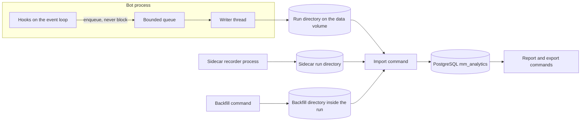

# Market-making capture and loss analysis

## 1. Purpose and scope

This spec defines two things. A recorder runs inside a Hummingbot bot and writes everything the bot sees, decides, and sends to local files. An offline analysis tool reads those files after the run and explains where the money went.

The operator is one person running small market-making bots through hummingbot-api. The reference run is `pmm_mister` (`controllers/generic/pmm_mister.py`) on `backpack_perpetual` SOL-USDC with a 50 USDC allocation, run on October 15 (instance `pmm_sol_backpack_20261015-20261015-002741`). The stock trading database for that run holds 37,092 executor rows and 108 fills. 36,201 executors closed with `INSUFFICIENT_BALANCE` before placing an order. The fills bought 4.64 SOL and sold 4.24 SOL, so the run ended holding 0.40 SOL long. The database has no order book, no mid-price series, no balance or position history, and no record of why the controller skipped a level. Nobody can say from that data whether the loss came from adverse fills, fees, funding, the retained position, or quotes that never reached the venue. This spec exists to make that question answerable for every future run.

### Rules that apply everywhere

- **Raw first.** Record every input exactly as the bot received it and keep it. Everything derived (parsed events, ledgers, metrics, reports) is recomputable from the recorded files. When in doubt, record the raw value and decide its meaning later.
- **Capture never changes trading.** The recorder never blocks, delays, rejects, or reorders an order, a cancel, or an event-loop task beyond the overhead budget in section 5.1. It adds no subscriptions, no REST requests, no signal handlers, and no new waits to the trading process. The only wait it adds is a bounded flush at run end, after the strategy has stopped (section 5.2). If capture fails, trading continues and the analysis sees a gap.
- **Unknown is not zero.** A missing value is null with a reason. A metric with missing inputs reports its coverage, never a fabricated number.
- **Exact decimals.** Financial values are decimal strings in files and `NUMERIC` or Python `Decimal` in analysis. No financial value used by the analysis may pass through a binary float.

### In scope

- Any V2 strategy that runs controllers through `StrategyV2Base`, on any connector built on `web_assistant`. Decision traces (section 6.3) are required for `pmm_mister`. Other controllers get tick records without a trace.
- Linear perpetuals and spot. The reference run is a USDC-margined linear perpetual.
- One bot per hummingbot-api instance, analyzed one run at a time or across runs.

### Out of scope

- V1 strategies (`pure_market_making`, `cross_exchange_market_making`) and hedge linkage. Raw transport capture still works for them because it sits in `web_assistant`, but they get no decision records.
- Inverse contracts, options, and AMM connectors.
- Importing old trading databases. Past runs have no book data, so they cannot answer the questions in section 2.
- High availability, replication, backup schedules, and object storage. The files on the mounted data volume are the record.
- A web UI.

## 2. Questions the analysis must answer

Every capture requirement in this spec exists to answer one of these questions. The report (section 10.6) has one section per question.

| # | Question | Evidence it needs |
|---|---|---|
| Q1 | How much did I make or lose, and in which component: spread capture, inventory moves, fees, or funding? | Venue fills with exact prices and fees, funding payments, book mids at every fill and over time, opening equity and positions. |
| Q2 | Which fills lost money afterwards, and what did they have in common? | Fills, the venue book before and after each fill, the decision and executor behind each fill, market state at fill time. |
| Q3 | When was I not quoting, and why? | Every controller tick with its decision state and trace, every budget check, every executor that closed without an order, venue rejections. |
| Q4 | How did inventory build up, and what did holding it cost? | Position after every fill, mids over time, executors stopped with `keep_position`, global take-profit and stop-loss events. |
| Q5 | Were my orders stale or slow? | Order request, dispatch, acknowledgment, and cancel times; fills that arrived after a cancel request; event-loop lag. |
| Q6 | Did the bot see the market correctly? | The bot's own view of the book at each tick, the venue book rebuilt from raw frames, sequence gaps, disconnects. |
| Q7 | Did take-profit, stop-loss, refresh, and effectivization rules help or hurt? | Barrier events with the prices that fired them, refresh and effectivization reasons, the outcome of each executor. |
| Q8 | Is one configuration better than another? | Configuration content per run, all of the above per run, and market conditions per run. |

## 3. What the stock database loses

These facts at `HEAD` (`9af100d68`) explain why the stock database cannot answer section 2 and why capture happens before Hummingbot parses anything.

- `hummingbot/core/web_assistant/connections/ws_connection.py:145-150` decodes WS JSON and `hummingbot/core/web_assistant/connections/data_types.py:114-130` (`RESTResponse.json`) decodes REST JSON, both with Python floats. Every connector value after that point may already be rounded.
- `hummingbot/model/decimal_type_decorator.py:13-38` stores `SqliteDecimal(6)` columns as `int(value * 10**6)`, which truncates finer precision in orders, fills, and positions.
- `hummingbot/connector/client_order_tracker.py:334-359` stamps `OrderFilledEvent.timestamp` with local time, not `TradeUpdate.fill_timestamp`.
- `hummingbot/core/data_type/in_flight_order.py:44-54` gives `TradeUpdate.is_taker` a default. `hummingbot/connector/derivative/backpack_perpetual/backpack_perpetual_derivative.py:541-572` never sets it, even though the venue's order-update frame carries a maker flag `m`. Only the raw frame records the fill's maker or taker role.
- `backpack_perpetual_derivative.py:846-863` keeps only the newest funding payment from each poll of `wapi/v1/history/funding`. The raw REST response holds the full list.
- `backpack_perpetual_derivative.py:673-686` reports Backpack's `netEquity` as the USDC total balance. That figure already includes unrealized P&L, so it is not cash.
- `hummingbot/core/data_type/order_book_tracker.py:634-665` applies Backpack depth diffs without checking that each diff's first update ID follows the previous diff's last update ID, and `hummingbot/core/data_type/order_book_tracker_data_source.py:15,129-133` takes a fresh REST snapshot only once an hour. After a gap, the bot can trade on a wrong book for up to an hour.
- `hummingbot/connector/markets_recorder.py:217-230` overwrites one `Executors` row per executor. Executor history and `custom_info` changes are lost. Positions are also overwritten, and `realized_pnl_quote` is never updated (`markets_recorder.py:237-259`).
- `hummingbot/model/controllers.py:6-16` stores controller configuration only. `processed_data` and the reasons behind each decision are never stored.
- `hummingbot/connector/budget_checker.py:97-105` zeroes a candidate that does not fit, and `hummingbot/core/data_type/order_candidate.py:255-270` clears its collateral entries when it does. The values that explain an `INSUFFICIENT_BALANCE` close are gone by the time the executor logs it.
- `hummingbot/connector/markets_recorder.py:426-435` stores `trade_fee_in_quote = 0` when fee conversion fails, so a zero there does not mean a free trade.

## 4. Design

The design has three parts with one direction of data flow.



1. The **recorder** runs in the bot process. Hooks on the event loop turn observations into JSON lines and enqueue them. A writer thread writes them to segment files.
2. The **sidecar** is a separate process, part of the default deployment, that records public market channels the connector does not subscribe to (section 8).
3. The **analysis tool** is a command-line program that runs after the run, or during it against closed segments. It imports files into PostgreSQL, parses raw frames, builds the ledger and book history, computes metrics, and writes the report (section 10).

PostgreSQL is never on the trading path. The bot process opens no database connection for analytics.

## 5. Recorder

### 5.1 Execution model

- Every hook runs on the asyncio event loop thread. A hook takes `seq = next(counter)`, reads `time.time_ns()` and `time.monotonic_ns()`, serializes the record to one UTF-8 JSON line, and appends the bytes to the queue. Serialization happens in the hook because the event loop can change the objects being recorded, and the writer thread must never read them.
- `seq` is one counter per run, starting at 1. The writer thread takes `seq` values from the same counter for the records it creates itself. Because every hook runs on the event loop thread, `seq` order among hook records is the order in which the bot observed things. The analysis uses `(run_id, seq)` as the total order within a run.
- The queue is a `collections.deque` of byte strings. **Priority records** are every local-evidence kind (section 5.4), plus `ws_in`, `ws_out`, `rest`, and `rest_body` records on an authenticated connection or request, which the recorder knows because redaction removed a credential from it or from an earlier `ws_out` on the same connection. Priority records carry orders, fills, balances, positions, and decisions. Bulk records are everything else, mainly public market data. Bulk records may fill the queue up to `queue_max_bytes`. Priority records may fill it up to `queue_max_bytes + priority_reserve_bytes`, so a burst of public data never pushes out a fill. When an append would exceed its bound, the hook drops the record and increments a drop counter. The `seq` is still consumed, so the gap is visible on disk. The writer writes a `capture_gap` record with the dropped `seq` range and whether any priority record was dropped as soon as it can. Hooks never wait for space.
- A hook catches every exception it raises, increments an error counter, and logs the first 10 occurrences per hook. An exception in capture code never reaches the caller.
- The writer is one `threading.Thread`. It only writes bytes, calls `os.fsync`, and compresses closed segments with `gzip`. It does no JSON encoding. It calls `os.fsync` at least every `flush_interval_ms`. A crash loses at most the queue contents plus `flush_interval_ms` of records.
- Hooks read order books through `OrderBook.bid_entries()` and `ask_entries()` and stop after `analytics.book_levels` levels. They never call `OrderBook.snapshot`, which builds pandas DataFrames.

**Overhead budget.** Every hook measures its own duration with `time.perf_counter_ns()`. Each `host` record reports, per hook, the call count, the total duration, and counts in fixed log2 duration buckets (1 µs, 2 µs, 4 µs, and so on up to 1 s) since the previous `host` record. Bucket counts merge across records, so the analysis can compute a p99 over any interval. At the reference load (section 5.2) these limits hold over a 1-hour run:

| Hook | p99 limit |
|---|---|
| `tick` | 2048 µs |
| `executor_state` (per executor per control-loop iteration, including the change check) | 512 µs |
| `host` (once per second, including the psutil and `statvfs` calls and the bucket counts) | 1024 µs |
| `ws_in`, `ws_out`, `rest`, `rest_body`, `log` | 64 µs plus 8 µs per KiB of payload |
| Every other hook | 64 µs |
| All hooks together | 2% of wall time over any 60-second window |

For fixed limits, a limit is met when the upper edge of the bucket that holds the p99 is at or below the limit, which is why those limits sit on bucket edges. Payload-sized hooks are checked from the records themselves: every record carries `hook_ns` and its payload length, so the p99 of `hook_ns - 8000 * payload_KiB` over the run must be at most 64 µs. Backpack's funding history poll, for example, returns about 17 KiB with no `limit` parameter (`backpack_perpetual_derivative.py:847-853`), so its `rest_body` hook is allowed about 200 µs.

**Cost on the order path.** Between a controller decision and the venue POST, these hooks run synchronously on the event loop: the `tick` hook in `control_task`'s `finally` block, then for each executor the tick creates its creation `executor_state`, `budget_check`, `executor_order`, and first-iteration `executor_state`, then `order_request` and `order_dispatch` (`controller_base.py:268-278`, `executor_orchestrator.py:536-567`, `executor_base.py:178-212,345-375`, `position_executor.py:386-457,794-818`). All executors created in one tick run their first iteration before the first `_create_order` task, because each `executor.start()` and Backpack's `buy` and `sell` (`backpack_perpetual_derivative.py:257-296`) schedule their work with `safe_ensure_future`. At the p99 limits the hooks before the first dispatch add up to `2048 + N*(512 + 64 + 64 + 512) + 64 + 64 = 2176 + 1152*N` µs, where `N` is the number of `CreateExecutorAction`s in the tick. That is 3.3 ms for one level and 6.8 ms for the reference config's four levels. The `rest` hook runs when the response headers arrive, after the order has reached the venue, so it delays only the processing of the acknowledgment. Every record carries its own `hook_ns` (section 5.3), so the analysis can separate capture time from the bot's own latency. Acceptance criterion 13 checks these limits on a live run.

### 5.2 Run lifecycle and files on disk

The recorder writes under `analytics.dir`, which defaults to `data/analytics` relative to the Hummingbot root. In a hummingbot-api container this is `/home/hummingbot/data/analytics`, inside the mounted `bots/instances/<instance>/data` directory on the host. Files there survive container removal, and hummingbot-api's archive step moves or tars that directory with the rest of the instance.

```
data/analytics/
  <run_id>/
    run.json                      run_start body; run_end body added at a clean stop
    seg-000001.jsonl.gz           closed segments
    seg-000002.jsonl              the active segment
    manifest.jsonl                one line per closed segment
    backfill/<backfill_id>/       written by the backfill command (section 9)
```

- **Run.** A run is one strategy start in one process. It becomes active at the top of `TradingCore.start_strategy` (`hummingbot/core/trading_core.py:441`). The recorder attaches its `connector_event` listeners to each connector immediately after `connector_manager.create_connector` returns (`trading_core.py:242-244,679-681`), before the clock starts the connector. It writes `run_start` after `_initialize_v2_strategy` returns (`trading_core.py:475`), when connectors and controllers exist, and before `_start_strategy_execution` starts the clock (`trading_core.py:483`). Records emitted between activation and `run_start`, such as connector construction logs, are kept and get lower `seq` values than `run_start`. The run ends at the end of `StopCommand.stop_loop` (`hummingbot/client/command/stop_command.py:20-56`) or `TradingCore.shutdown` (`trading_core.py:779-822`), whichever runs, after cancels, connector removal, and `stop_clock`. `run_id` is a UUIDv7. Records emitted while no run is active are discarded and counted in the next `run_start`.
- **Clean stop.** At run end the recorder writes `run_end`, drains the queue, closes the active segment as described below, and rewrites `run.json` with the `run_end` body. This happens on the event loop thread and may block for at most 2 seconds, because the strategy is already stopped. After 2 seconds the recorder gives up and leaves the segment open.
- **Segments.** A segment is UTF-8 JSON Lines, one record per line. The active segment is uncompressed, so a crash leaves at most one partial last line. The writer closes a segment when it reaches `segment_max_bytes` or `segment_max_seconds`. Closing writes `seg-N.jsonl.gz`, fsyncs it, appends `{file, first_seq, last_seq, records, bytes, sha256}` to `manifest.jsonl`, fsyncs the manifest, and then deletes `seg-N.jsonl`.
- **No recovery at startup.** The recorder never reads or changes earlier runs. A run whose `run.json` has no `run_end` crashed or was killed, for example by `docker stop` after hummingbot-api's 15-second wait. The import recovers it (section 10.1). The recorder installs no signal handlers.
- **Disk floor.** At run start, the recorder refuses to enable capture when free space on the volume is below `min_free_bytes`, and the bot logs an error and runs without capture. During the run, when free space falls below `min_free_bytes`, the writer writes a `capture_gap` record of type `disk_low` and stops writing bulk records. It keeps writing priority records until free space falls below `hard_min_free_bytes`, then writes a `disk_full` gap and stops writing. Priority records are a small share of the volume, so the second floor buys hours. Trading is unaffected in both cases.
- **Size estimate.** A 60-second sample of Backpack public streams for `SOL_USDC_PERP` on 2026-10-18 (a Sunday) measured 47 depth frames per second, about 29 MiB per hour of raw depth payload, and 34 MiB per hour across depth, bookTicker, markPrice, and trade. With the record envelope this is roughly 70 MiB per hour uncompressed for one pair. This is one quiet sample, and volatile periods can be several times higher. The default `min_free_bytes` of 5 GiB is about 70 hours of headroom at that rate.

### 5.3 Record envelope

Every record is one JSON object with these fields.

| Field | Type | Meaning |
|---|---|---|
| `seq` | int | Per-run observation order. Gapless unless a `capture_gap` record says otherwise. |
| `run_id` | string | Run identity. |
| `kind` | string | Record kind from section 5.4. |
| `t_wall_ns` | int | `time.time_ns()` when the hook ran. |
| `t_mono_ns` | int | `time.monotonic_ns()` when the hook ran. Compare only within one run. |
| `hook_ns` | int | The hook's own duration from `time.perf_counter_ns()`, measured up to the point where the envelope is assembled. The hook serializes `body` first and adds the envelope around it, so `hook_ns` covers the serialization. |
| `connector`, `trading_pair` | string or null | Set when the record concerns one market. |
| `controller_id`, `executor_id`, `client_order_id`, `exchange_order_id` | string or null | Set whenever known, so the import can index them without parsing the body. |
| `body` | object | Kind-specific fields. Decimal values are strings. |

Raw payloads go in `body.text` when they are text and in `body.b64` (base64) when they are bytes that are not valid UTF-8. JSON string escaping round-trips text exactly, so the original bytes are `body.text.encode("utf-8")`.

**Account identity.** Each connector account has an `account_id` of the form `<connector>:<first 16 hex digits of SHA-256 of the API key>`. The hash identifies the key without revealing it. `run_start` lists the `account_id` of every connector, and every record that concerns one connector carries it in `body.account_id`. A venue subaccount with its own API key gets its own `account_id`. Two different API keys for the same venue account get two `account_id` values, and the analysis treats them as two accounts.

### 5.4 Record kinds

Records split into two kinds of evidence. **Venue evidence** is what a venue sent or what the bot sent to it (`ws_in`, `ws_out`, `rest`, `rest_body`). Parsers can rebuild venue facts from it. **Local evidence** is what the bot itself observed, believed, or decided (every other kind). It has no raw frame behind it and is itself the original record.

| Kind | Written when | Body |
|---|---|---|
| `run_start` | After the strategy and its connectors are built, before the clock starts (section 5.2). | Hummingbot version, `HB_IMAGE` environment value if set, Python version, host name, connector names and trading pairs with each connector's `raw_transport` and `redaction` status (section 5.5), the full text of `conf_client.yml` (redacted), every controller and script config file, the full source text and SHA-256 of every loaded controller module, `conf_fee_overrides.yml`, the effective `analytics` settings, and the count of records discarded before the run. |
| `run_end` | The run ends (section 5.2). | Path (`stop_command` or `shutdown`), reason if known (`kill_switch`, `exception`, `user`), exception text if any, final counters (records, drops, hook errors). |
| `ws_in` | Each message returned by `self._connection.receive` in `WSConnection._read_message` (`ws_connection.py:81-86`), before any processing. | `connection_id`, URL, aiohttp message type (`TEXT`, `BINARY`, `PING`, `PONG`, `CLOSE`, `CLOSED`, `ERROR`), payload as `text` or `b64`, close code and extra if present. |
| `ws_out` | Each `WSConnection.send` (`ws_connection.py:55`). | `connection_id`, payload after redaction. |
| `ws_conn` | `WSConnection.connect` and `disconnect` (`ws_connection.py:30-53`), and receive errors or timeouts. | `connection_id`, URL, event (`connect`, `disconnect`, `error`, `timeout`), error text. |
| `rest` | In `RESTConnection.call` (`rest_connection.py:10-24`), when the response headers arrive or the request fails. The hook adds no await. | `request_id`, method, URL, query parameters (`RESTRequest.params`, which aiohttp receives separately from the URL), request headers and body, all after redaction, the final request URL from `aiohttp_resp.request_info.url` with redacted query values when a response exists, `t_sent_mono_ns`, response status, response headers, error text. |
| `rest_body` | The first time `RESTResponse.json` or `RESTResponse.text` (`connections/data_types.py:114-134`) reads the body. Both methods change to call `await self._aiohttp_response.read()` first and record the bytes. That is the read that aiohttp's `json()` and `text()` already perform, and aiohttp caches the body, so the call adds no network wait. | `request_id`, body as `text` or `b64`. A response whose body the connector never reads has no `rest_body` record, and the analysis treats its body as unread. |
| `order_request` | Entry of `ExchangePyBase._create_order` (`exchange_py_base.py:400`). | `client_order_id`, side, order type, amount and price as passed, `position_action`, and the keyword arguments. |
| `order_dispatch` | Immediately before the call to `_place_order_and_process_update` (`exchange_py_base.py:462`). | `client_order_id`, amount and price after quantization. |
| `order_result` | When `_place_order_and_process_update` returns or `_create_order` handles a failure. | `client_order_id`, `exchange_order_id`, outcome (`accepted`, `failed`), exception class and text. |
| `cancel_request` | Entry of `ExchangePyBase._execute_cancel` (`exchange_py_base.py:573`). | `client_order_id`, `exchange_order_id` if known. |
| `cancel_result` | When `_execute_cancel` returns or raises. | `client_order_id`, outcome, exception text. |
| `tracker_update` | `ClientOrderTracker.process_order_update` and `process_trade_update` (`client_order_tracker.py:200,203`). | Every field of the `OrderUpdate` or `TradeUpdate` as the connector built it, including `fill_timestamp`, `is_taker`, and fee, with `float_tainted: true`. |
| `connector_event` | Every event the connector emits. Listeners for every `MarketEvent` are attached when each connector is created (section 5.2). | Event name and every field of the event object. |
| `tick` | Every iteration of `ControllerBase.control_task` (`controller_base.py:268-274`). See section 6.1. | Controller decision state, actions, trace, and the bot's view of market and account. |
| `budget_check` | Every `BudgetChecker.adjust_candidate` call (`budget_checker.py:82-105`). See section 6.2. | All operands of the balance check. |
| `executor_state` | Executor creation, every status change, every close, and every control-loop iteration in which `executor_info` serializes differently from the previous record for that executor. | Full `executor_info` including config and `custom_info`. |
| `executor_order` | Each `ExecutorBase.place_order` call (`hummingbot/strategy_v2/executors/executor_base.py:351-375`), after it returns the client order ID. | Executor ID, controller ID, level ID from the executor config, client order ID, side, order type, amount, price, `position_action`, and the order's purpose. For `PositionExecutor`, the purpose comes from the calling method: `place_open_order` (`position_executor.py:449`) is `open`, `place_close_order_and_cancel_open_orders` (`position_executor.py:493`) is `close`, and `place_take_profit_limit_order` (`position_executor.py:570`) is `take_profit`. |
| `barrier` | Each `PositionExecutor` exit decision listed in section 6.4. | Event type, close type, the price that triggered it, the barrier level, entry price, `keep_position`, and the order ID placed or cancelled. |
| `config_change` | `ControllerBase.update_config` (`controller_base.py:249`). | Controller ID, old and new config. |
| `controller_state` | `ControllerBase.start` (`controller_base.py:208-217`), which replaces the base method without calling it, and `RunnableBase.stop` (`hummingbot/strategy_v2/runnable_base.py:52`), when called on a controller. | Controller ID, event (`start` or `stop`), status before and after the call, and the calling function's name read from the call stack, for example `check_manual_kill_switch` (`scripts/v2_with_controllers.py:104-117`). Starts and stops are rare, so reading the stack costs nothing measurable. |
| `log` | Each log record from any `hummingbot` logger at or above `analytics.log_level`. | Logger name, level, message, exception text. |
| `clock` | Each `TimeSynchronizer.add_time_offset_ms_sample` (`time_synchronizer.py:44`). | Connector, `offset_ms` as `TimeSynchronizer` stores it, and `time.perf_counter_ns()` at the sample. That offset is venue time minus `time.perf_counter()`, not minus wall time (`time_synchronizer.py:65-70,92-93`). The analysis uses these records only to show the bot's own clock view in Q6. |
| `host` | Every second, from a task on the event loop. | Event-loop lag (actual minus scheduled wake time of a 1-second sleep), process CPU percent, RSS, open file count, queue depth and bytes, drop and error counters, free disk bytes, and the per-hook timing in section 5.1. |
| `capture_gap` | The writer detects dropped `seq` values or a disk floor. | Type (`queue_full`, `disk_low`, `disk_full`), `seq` range, count, and whether priority records were dropped. |

### 5.5 Redaction

The recorder and the backfill command (section 9) remove credentials and signatures from outbound records before writing them.

- A redaction table in the analytics module lists, per connector, the request headers, query parameters, and JSON paths in REST bodies and WS messages that carry credentials or signatures. The recorder replaces each value with the string `"<redacted>"` and lists the removed names in `body.redacted`. For `backpack_perpetual` the table holds the `X-API-Key` and `X-Signature` headers (`hummingbot/connector/derivative/backpack_perpetual/backpack_perpetual_auth.py:41-47`) and elements 0 and 1 of the `signature` array in WS subscribe messages (`backpack_perpetual_api_user_stream_data_source.py:77-95`). `X-Timestamp` and `X-Window` stay, because they explain request timing.
- For a connector without a table entry, the recorder omits outbound request headers, query strings, request bodies, and `ws_out` payloads entirely, and keeps only method, URL path, and timing. Inbound data is still recorded in full. `run_start` lists the connector with `redaction: outbound_omitted`.
- As a second check on every connector, the recorder replaces any exact occurrence of a secure connector config value (API key, secret, passphrase) in an outbound record with `"<redacted>"`.

Inbound frames are not redacted. `conf_client.yml` and connector config files are written with `"<redacted>"` in place of every field marked secure in the config map and every field whose name contains `password`, `secret`, or `passphrase` or ends in `_key`, case-insensitively. That covers `mqtt_bridge.mqtt_password` and `db_password`, which are not marked secure (`hummingbot/client/config/client_config_map.py:58-61,312-314`) but which hummingbot-api fills with the shared broker credentials (`/root/hummingbot-api/services/docker_service.py:331-332`).

## 6. Decision capture

### 6.1 Tick records

`ControllerBase.control_task` gains one hook. It writes a `tick` record in a `finally` block on every iteration, including iterations that return no actions, iterations skipped by the readiness check at `controller_base.py:269`, and iterations that raise.

| Field | Content |
|---|---|
| `tick_time` | `market_data_provider.time()`. |
| `gated` | `null` when the controller ran. Otherwise `market_data_not_ready` or `waiting_executor_update`, matching the two conditions at `controller_base.py:269`. A gated tick has only `tick_time` and `gated`. |
| `error` | Exception class, message, and traceback when `update_processed_data` or `determine_executor_actions` raised, otherwise `null`. |
| `processed_data` | `processed_data` after `update_processed_data` and `determine_executor_actions`, serialized with Decimals as strings, `ExecutorInfo` objects through their pydantic serialization, `pandas` objects as lists of records, and any other type as `{"__type__": <class name>, "repr": <repr>}`. |
| `actions` | Every returned action with its type, executor ID, `keep_position`, and full executor config. An empty list is recorded. |
| `custom_info` | `get_custom_info()`. |
| `trace` | The list of trace entries the controller produced during this tick (section 6.3). |
| `market_view` | For every connector and trading pair in the controller's markets: best bid and ask, mid, the top `analytics.book_levels` levels per side, `snapshot_uid`, and `last_diff_uid` from the `OrderBook`, plus mark price, index price, funding rate, and next funding time for perpetuals. These are the bot's own float values, recorded as it saw them. |
| `account_view` | For every connector: total and available balance per token from `get_balance` and `get_available_balance`, every position (side, amount, entry price, unrealized P&L, leverage), and every in-flight order (client and exchange IDs, state, side, price, amount, executed amount). |

The `tick` record is the bot's belief at decision time. Observation replay (section 10.5) reads it directly. Nothing has to be reconstructed to know what the bot saw.

### 6.2 Budget checks

`BudgetChecker.adjust_candidate` writes a `budget_check` record after it decides and before it returns. The record holds:

- The caller's `executor_id`. `ExecutorBase.adjust_order_candidates` (`executor_base.py:345`) sets a `contextvars.ContextVar` to its executor ID for the duration of its synchronous call, and the hook reads it. Calls from outside an executor record `null`.
- The candidate before adjustment: trading pair, side, order type, amount, price, `is_maker`, and leverage for perpetual candidates.
- The order, percent-fee, and fixed-fee collateral entries and the candidate amount, serialized immediately after `populate_collateral_entries` returns (`budget_checker.py:97`). They must be serialized there, before `adjust_from_balances` runs, because `adjust_from_balances` scales the same `TokenAmount` objects in place (`hummingbot/core/data_type/order_candidate.py:82,181,188,255-258`) and `set_to_zero` then clears them. A reference taken earlier would end up holding the scaled values.
- The per-token available balances from `_get_available_balances` (`budget_checker.py:122-146`), and the batch-local `_locked_collateral` per token. `_locked_collateral` only holds collateral reserved by earlier candidates in the same `adjust_candidates` batch and is reset at the start and end of each batch (`budget_checker.py:52,57`), so it is zero for the single-candidate check in `position_executor.py:814`.
- The output of the connector's `analytics_balance_components(token)`, a new optional connector method. It returns a list of signed terms whose sum equals what `get_available_balance(token)` returned. Each term has a name, a signed decimal value, and a category: `venue_available`, `own_orders_snapshot`, `own_orders_now`, `fills_since_snapshot`, or `balance_limit`. For `backpack_perpetual` the terms follow `backpack_perpetual_derivative.py:187-190`: `+netEquityAvailable` (`venue_available`), `+snapshot_margin` (`own_orders_snapshot`), `-in_flight_margin` (`own_orders_now`), and `+fills_margin` (`fills_since_snapshot`). When `get_available_balance` applies a configured balance limit (`hummingbot/connector/connector_base.pyx:409-412`), the method adds a final `balance_limit` term equal to the change the limit made. A connector without the method records `null`.
- `all_or_none`, whether the candidate was resized, and the adjusted candidate.

The Q3 budget breakdown (section 10.4) is computed from these values.

### 6.3 Decision trace

`ControllerBase` gains `trace(code: str, level_id: Optional[str] = None, **values)`. When capture is active it appends `{code, level_id, values}` to a per-controller list. When capture is inactive it returns immediately. The tick hook writes the list and clears it in its `finally` block on every iteration, whether capture is active or not, so the list never grows across ticks. A controller that never calls `trace` still gets complete tick records.

Trace calls pass only values the branch has already computed. Any further computation needed for a value, such as a difference or a ratio, happens inside `trace` under its exception guard, so a trace call can never raise into the controller.

The `pmm_mister.py` file under hummingbot-api's `bots/controllers/generic/` is mounted into every bot container, including bots on the stock image, whose `ControllerBase` has no `trace`. The instrumented `pmm_mister.py` must therefore produce the same actions as the uninstrumented file on the stock image, and on the analytics image with capture on and off (criterion 21). The same file is committed at `controllers/generic/pmm_mister.py`.

`pmm_mister` calls `trace` at each site below. A **blocking** code means the controller did not quote that level, or any level for controller-wide codes, because of it. An informational code records an event or a value without suppressing a quote. The order of blocking rows is the precedence order used by Q3 (section 10.4).

| Code | Blocking | Site at `HEAD` | Values |
|---|---|---|---|
| `position_mode_unverified` | yes, all levels | `pmm_mister.py:273-296,334-337` | Expected and actual position mode, exception text. |
| `global_close_active` | yes, all levels | `pmm_mister.py:344-354` | Close phase, attempt count. |
| `analysis_skipped` | yes, all levels | `pmm_mister.py:591-592` | The reference price that was not positive. |
| `active_not_trading`, `max_active_executors`, `cooldown`, `price_distance`, `below_min_position`, `above_max_position`, `position_profit_protection` | yes, per level | `pmm_mister.py:653-702` | The compared values, such as the current price, nearest executor price, and required distance for `price_distance`. Within this row, precedence follows the listed order. |
| `inventory_side_restriction` | yes, per level | `pmm_mister.py:1007-1056` | Current base percent, min, max, and target base percent, reference price, breakeven price, and the side allowed. |
| `zero_quantized_amount` | yes, per level | `pmm_mister.py:943-954` | Raw and quantized amount, trading rule step. |
| `reduction_price_below_breakeven` | yes, per level | `pmm_mister.py:956-965` | Proposed price, breakeven price. |
| `global_take_profit`, `global_stop_loss` | no | `pmm_mister.py:502-546` | Unrealized P&L percent, threshold, inventory activation values. |
| `global_close_waiting`, `global_close_retry_exhausted`, `global_close_zero_position`, `global_close_side_flip`, `global_close_zero_quantized` | no | `pmm_mister.py:398-465` | Position amount, side, attempt count. |
| `reference_price_fallback` | no | `pmm_mister.py:309,312` | The fallback used (previous price or the constant `100`), and the error that caused it. |
| `refresh_age`, `refresh_price_deviation` | no | `pmm_mister.py:727-736,1071-1083` | Executor ID, executor age and limit, or price deviation and tolerance. |
| `effectivize` | no | `pmm_mister.py:781-810` | Executor ID, time since fill, side timer. |

### 6.4 Executor exit decisions

`PositionExecutor` writes a `barrier` record at each of these points.

| Event type | Site at `HEAD` |
|---|---|
| `stop_loss`, `time_limit`, `trailing_stop`, `take_profit_market` | Calls to `place_close_order_and_cancel_open_orders` from `control_stop_loss`, `control_time_limit`, `control_trailing_stop`, and `control_take_profit` (`position_executor.py:519-560,782`). |
| `take_profit_placed`, `take_profit_cancelled` | `control_take_profit` placing and cancelling the limit take-profit order (`position_executor.py:546,550`). The reference config uses `LIMIT_MAKER` take-profits, so this is its normal take-profit path. |
| `take_profit_filled` | `process_order_completed_event` setting `CloseType.TAKE_PROFIT` (`position_executor.py:681`). |
| `close_retry` | `control_close_order` placing a new close order after a failed one (`position_executor.py:384`). |
| `early_stop` | `early_stop` (`position_executor.py:618`), with `keep_position` and the calling function's name from the call stack. The analysis labels the stop `controller_action` when the same `StopExecutorAction` appears in a `tick` record, `orchestrator_shutdown` when the caller is the orchestrator's shutdown loop (`executor_orchestrator.py:412`), and `strategy_action` otherwise, for example the manual kill switch (`scripts/v2_with_controllers.py:104-112`). |

## 7. Integration points

| Location at `HEAD` | Records |
|---|---|
| `hummingbot/core/web_assistant/connections/ws_connection.py:30-86` | `ws_in`, `ws_out`, `ws_conn` |
| `hummingbot/core/web_assistant/connections/rest_connection.py:10-24` | `rest` |
| `hummingbot/core/web_assistant/connections/data_types.py:114-134` | `rest_body` |
| `hummingbot/connector/exchange_py_base.py:400,462,573` | `order_request`, `order_dispatch`, `order_result`, `cancel_request`, `cancel_result` |
| `hummingbot/connector/client_order_tracker.py:200,203` | `tracker_update` |
| `hummingbot/connector/budget_checker.py:82-146` | `budget_check` |
| `hummingbot/connector/derivative/backpack_perpetual/backpack_perpetual_derivative.py:156-190` | `analytics_balance_components` |
| `hummingbot/connector/time_synchronizer.py:44` | `clock` |
| `hummingbot/strategy_v2/controllers/controller_base.py:249,268-274` | `tick`, `config_change`, and the `trace` method |
| `hummingbot/strategy_v2/executors/executor_base.py:163-215,345,351-375` | `executor_state`, `executor_order`, and the executor ID context for `budget_check` |
| `hummingbot/strategy_v2/controllers/controller_base.py:208-217` and `hummingbot/strategy_v2/runnable_base.py:52` | `controller_state` |
| `hummingbot/strategy_v2/executors/position_executor/position_executor.py:384,519-560,546,550,618,681,782` | `barrier` |
| `hummingbot/core/trading_core.py:242-244,441,475,483,679-681,779-822` and `hummingbot/client/command/stop_command.py:20-56` | Run activation and end, `run_start`, `run_end`, `connector_event` listeners, `host` task |
| `controllers/generic/pmm_mister.py` sites in section 6.3 | `trace` calls |

The recorder is a module-level singleton. Each hook calls a function that returns immediately when capture is disabled, so a disabled recorder costs one attribute check per hook.

`PerpetualDerivativePyBase._create_order` (`hummingbot/connector/perpetual_derivative_py_base.py:245-281`) delegates to `ExchangePyBase._create_order`, so perpetual orders go through the same hooks. Connectors that open sockets or HTTP sessions without `web_assistant` get no venue evidence records. `run_start` lists each connector with a `raw_transport` flag so the gap is visible before analysis.

## 8. Sidecar recorder

The sidecar records public market data that the trading connector does not subscribe to, without touching the trading process. It is a separate command:

```
python -m hummingbot.analytics sidecar --connector backpack_perpetual --pairs SOL-USDC --dir data/analytics
```

- It opens its own WebSocket connection with its own `aiohttp` session and throttler. It shares no objects with a bot.
- It subscribes to every public channel in a per-connector channel table. For `backpack_perpetual` the table is `bookTicker`, `depth`, `trade`, `markPrice`, `liquidation`, and `openInterest`, per the Backpack public stream documentation.
- It fetches a REST depth snapshot at start and after every reconnect or detected depth sequence gap, so its depth stream rebuilds on its own.
- It writes the same envelope and segment format as the recorder into its own run directory with its own `run_id`, with `run.json` marking it `"source": "sidecar"`, and with `kind` values `ws_in`, `ws_out`, `ws_conn`, `rest`, `rest_body`, `host`, and `capture_gap`.
- In hummingbot-api, it runs as its own container from the same image with the instance's `data` directory mounted.

The analysis joins sidecar data to a bot run by connector, trading pair, and venue time. Sidecar receipt times are the sidecar's, not the bot's, so the analysis never uses them as evidence of what the bot knew. Sidecar depth frames carry the venue's engine timestamps and may serve as the book reference for markouts (section 10.3).

## 9. Post-run backfill

The backfill command fetches the venue's own history for a run's trading window:

```
python -m hummingbot.analytics backfill --run data/analytics/<run_id> [--from <iso> --to <iso>]
```

- The trading window defaults to the run's start time in `run.json` through its `run_end` time. For a run without `run_end`, the end is the `t_wall_ns` of its last recovered record plus `--tail`, which defaults to 10 minutes. `--from` and `--to` override both. The window never depends on records written by earlier backfills.
- For `backpack_perpetual` it pages through fill history, order history, funding payment history, and deposit and withdrawal history for the account from the window's start to the time of the call. Entries after the trading window are labeled post-run activity. The analysis never attributes them to the run, and uses them only to bring the ledger forward to the backfill's balance and position responses. A resting GTC order can fill after the bot stopped and funding keeps accruing on a held position, so these entries are needed to reconcile against the venue's state at the time of the call. It then fetches one balance response, one position response, and one mark price response (`api/v1/markPrices`, `backpack_perpetual_constants.py:48`). Outbound records go through the redaction in section 5.5.
- Each call writes a new directory `backfill/<backfill_id>/` inside the run directory, in the same segment format. `<backfill_id>` is a new UUIDv7 and is the `run_id` in every envelope it writes, with its own `seq` counter starting at 1. Its `run.json` holds `"source": "backfill"`, `source_run_id` set to the bot run's `run_id`, and the window. Its records are `rest` and `rest_body`.
- It reads credentials the same way Hummingbot does, from the instance's encrypted connector config with the password from `CONFIG_PASSWORD` or a prompt. It derives the `account_id` (section 5.3) from those credentials and refuses to run when it differs from the `account_id` that the run recorded for the connector. Its `run.json` records the `account_id`.
- It requests the connector's server time (`api/v1/time` for Backpack) immediately before and immediately after its balance, position, and mark price requests, so the analysis can place the backfill's own windows in venue time.

Calling backfill twice writes two directories with overlapping records. The import deduplicates them by economic identity (section 10.1). Backfill fills gaps left by crashes and by the connector's partial polling (section 3), and it gives the ledger a venue-side reconciliation source. A run without backfill is still analyzable, and its report says that venue reconciliation was not done.

## 10. Offline analysis

### 10.1 Import

`python -m hummingbot.analytics import --run <dir>` loads a run directory, including its backfill directories and any sidecar run it names with `--sidecar <dir>`, into PostgreSQL. The database is `mm_analytics` on the hummingbot-api `postgres:16` service, reached from the host at `127.0.0.1:5432`. The command reads the DSN from the `ANALYTICS_DATABASE_URL` environment variable. The bot never reads it.

**Segment recovery.** The import reads each run directory in whatever state a crash or rotation left it.

| State of segment N | What the import does |
|---|---|
| `seg-N.jsonl.gz` listed in `manifest.jsonl` | Verifies the SHA-256 and reads it. Ignores any leftover `seg-N.jsonl`. |
| `seg-N.jsonl.gz` present but not listed | Treats it as incomplete and ignores it. Reads `seg-N.jsonl` instead. |
| Only `seg-N.jsonl` | Reads every complete line. Discards a partial last line and reports its byte count. |
| A partial last line in `manifest.jsonl` | Ignores that line. |

A run without `run_end` gets a `crash` gap from its last record's `t_wall_ns` to the end of the backfill window or, if there is none, to the end of the analysis. The import never writes to the run directory.

**Tables.**

- The import is idempotent on `(run_id, seq)`.
- Raw records go into one table `records` keyed by `(run_id, seq)`, with the envelope fields as indexed columns, the raw payload as `bytea`, and the rest of `body` as `jsonb`. The payload is stored as bytes because `jsonb` and `text` cannot hold a NUL character and `jsonb` normalizes numbers and whitespace. `rest` and `rest_body` records join on `request_id`.
- A versioned parser per connector turns venue evidence into normalized rows: `fills`, `orders`, `order_events`, `funding`, `transfers`, `book_deltas`, `book_snapshots`, `public_trades`, `positions_reported`, and `balances_reported`. Every row carries the `(run_id, seq)` of its source record and the `parser_version`. Parsers decode JSON with `parse_float=Decimal` and `parse_int=Decimal`. A new parser version adds rows with the new version. Reports name the parser version they used.
- Local evidence is imported as-is into `ticks`, `budget_checks`, `executor_states`, `barriers`, `traces`, `logs`, and `host_samples`.
- Every Backpack timestamp keeps its raw value and unit. Private `T` and `E`, depth `T` and `E`, and trade `T` and `E` are microseconds per the venue documentation.

**Economic identities.** The same fact seen in a WS frame, an ordinary REST poll, and a backfill becomes one economic row with several sources.

| Fact | Identity | Conflicting values for one identity |
|---|---|---|
| Fill | `(venue, account_id, instrument, exchange_trade_id, exchange_order_id, side)` | Reported as a conflict. The ledger uses the value from the most recent backfill, else the WS frame. |
| Funding payment | `(venue, account_id, instrument, funding_time)` | Same rule. |
| Order | `(venue, account_id, exchange_order_id)`, linked to `client_order_id` | States are kept as an event history, not merged. |
| Transfer, deposit, or withdrawal | `(venue, account_id, transfer_id)` | Same rule as fills. |

Two of the account's own orders matched by one venue trade ID stay two fills. A venue without stable trade IDs needs a documented rule in its parser, and the import reports ambiguous matches instead of merging them.

### 10.2 Ledger

The ledger tracks changes in equity from an opening state that the venue reports. It never needs the account's absolute cash, which on Backpack's unified margin account is not reported directly.

- **Venue clock.** The analysis converts local monotonic time to venue time with offsets computed from raw evidence. Each `rest` and `rest_body` pair of the connector's server-time request (Backpack `api/v1/time`, `backpack_perpetual_constants.py:39`) gives one sample: the offset is the server time minus the midpoint of `t_sent_mono_ns` and the `rest` record's `t_mono_ns`, and the uncertainty is half the round trip. Each conversion uses the nearest sample from the same run directory, because monotonic times from different processes are not comparable. A backfill directory uses the server-time pairs it requested itself (section 9). A connector without such pairs gets an offset estimated as the minimum, over private fill frames, of receipt time minus venue time, labeled `offset_estimated`.
- **Windows and quiet cuts.** A REST response reflects the venue state at some unknown moment between the request's send time and the response's receipt time. That interval, converted to venue time and widened by the offset uncertainty, is the response's **window**. A balance response and a position response form a **quiet cut** when no fill, funding payment, deposit, withdrawal, or transfer has a venue time between the earlier window's start and the later window's end. Every such event before a quiet cut is reflected in both responses, and no event after it is.
- **Opening state.** The ledger opens at the first quiet cut in the run. For Backpack the balance response is `collateralQuery` (`backpack_perpetual_derivative.py:679-682`) and the position response is `api/v1/position`. `E_open` is the venue equity (defined below) from the balance response. `t_open` is the midpoint of the balance response's window, and `mid_open` is the mid at `t_open`. The position response supplies only the opening position size and entry price, which no event changed between the two windows. Equity is never moved to the position response's time, because the price can move between the two responses. Fills before the cut are listed as pre-opening fills and are not attributed. Fills after it are applied. A run without a quiet cut is `opening_unresolved`, and the report shows the fills that overlap every candidate pair.
- **Venue equity.** For Backpack, venue equity is `netEquity` from the collateral response by default. Backpack's margin documentation defines net equity as total collateral value plus unrealized P&L, and Hummingbot uses it as the total balance (`backpack_perpetual_derivative.py:673-686`). The parser checks this as a diagnostic on every run. For each pair of comparable balance responses with no fill, funding payment, or transfer between them, it compares the change in `netEquity` with the position times the change in mark price between the two balance windows, with a tolerance of the absolute position times the mark range inside both windows plus 0.01 USDC. The parser switches to `netEquity` plus the collateral response's unrealized P&L field, both for `E_open` and at every reconciliation, only when most eligible pairs show `netEquity` flat within tolerance and fail the mark-move test. With no eligible pair, it keeps `netEquity` and labels the run `equity_definition_unverified`. The report states which definition it used and the diagnostic's counts.
- **Marked equity.** `E(t) = E_open + pos_open*(mid(t) - mid_open) + Σ s*q*(mid(t) - p) - fees + funding + external_flows`, where the sum, fees, funding, and flows cover venue times from `t_open` to `t`. The same formula holds for spot when fees are paid in the quote token, because a fill moves base by `s*q` and quote by `-s*q*p`. A fee paid in another token reduces that token's balance, so its later price move is part of equity: each such fee adds `-fee_qty*(mid_token(t) - mid_token(t_fill))`. `E(t)` needs only mids at `t` and, for non-quote fees, at the fill. When the book is not known at `t`, `E(t)` uses the venue mark price from the latest `markPrice` frame and is labeled `mark_valued`. The venue's unrealized P&L at opening is inside `E_open`, so the ledger never adds it again. The difference between the venue's mark price and `mid_open` is reported as the opening valuation difference.
- **Linear perpetual.** A fill changes the position by `s*q` and updates the average entry by weighted average cost. FIFO is available as an option. Both are declared in the report. Contract notional is never debited from equity.
- **Spot.** A fill moves base and quote by the traded amounts, and the fee reduces the balance of the token it was charged in. `E_open` is the venue-reported balances valued at `mid_open`.
- **Fees.** `fees` is the total fee cost, positive when paid and negative for a rebate. A fee in a token other than the quote is valued at the mid of that token at the fill time, and the valuation is labeled.
- **Funding.** The ledger uses the signed amount from the venue's payment record from the account's point of view. Positive means received. The ledger never derives the sign from the funding rate.
- **Reconciliation.** At every later quiet cut, and at every single balance or position response whose window contains no fill, funding payment, or transfer, the report compares the ledger with the venue. A response whose window contains one of those events is not comparable and is skipped. A position difference is an unresolved entry. Equity is compared at the midpoint of the balance response's window: the difference between `E(t)` there and the venue equity is a residual with these components: mark price versus mid, valuation timing (the position times the range of the mid inside that window, and the same at the opening balance window), assets in the account that the bot did not trade, fees or funding missing from the capture, and unexplained. At a backfill's balance and position responses, which arrive after the run has ended, `E(t)` uses the mark price fetched in the same backfill call and includes funding and transfers up to that call. The ledger never invents a balancing trade.

### 10.3 Book reconstruction and reference validity

The analysis rebuilds each venue book from raw REST depth snapshots and WS depth diffs, from the bot's own capture and from a sidecar run when one is imported.

- For Backpack, a diff is continuous when its `U` equals the previous diff's `u` plus 1. A snapshot with `lastUpdateId` starts a continuous stretch at the first diff whose range covers `lastUpdateId + 1`.
- The book state at venue time `t` is **known** on a stream when a continuous stretch covers `t` and a frame stamped at or after `t` arrived on that stretch before it ended. The second condition proves that no diff between the last applied frame and `t` was missed. Silence on a continuous stream means the book did not change, so a book that has not changed for 10 seconds is still a valid reference.
- The bot's stream and the sidecar's stream report the same venue book on the same engine clock. A reference uses the bot's stream when the book is known there, else the sidecar's stream, and the observation records which one.
- A mid is undefined when either side is empty or the book is crossed.
- For a fill at venue time `t_f`, `m0` is the mid of the known book after applying every diff stamped strictly before `t_f`. When a diff carries the same timestamp as the fill and the venue gives no sequence linking the two streams, the observation is flagged `m0_tie_uncertain`. `mh` is the mid of the known book at `t_f + h`.
- The venue clock is the matching-engine timestamp (`T` on Backpack) on both the fill and the depth frame, so no clock alignment is needed between them. A venue without engine timestamps on both streams gets markouts on the local receipt clock, labeled `clock_basis = receipt` and never mixed with venue-clock results.
- A horizon is `pending` when the run ended before `t_f + h`. It is `invalid` with reason `book_unknown` when the book is not known at `t_f` or `t_f + h`.
- Default horizons are 1, 5, 15, 60, and 300 seconds.

**The bot's view versus the venue book (Q6).**

- The bot's **book watermark** at a tick is `max(snapshot_uid, last_diff_uid)` from its `market_view`, because applying a snapshot updates only `snapshot_uid` (`hummingbot/core/data_type/order_book.pyx:96-97,137`). On Backpack, snapshot `lastUpdateId` and diff `u` values share one sequence, so the two are comparable.
- A `bot_book_gap` interval starts at the first diff on the bot's stream that is not continuous with the previous one and ends at the first tick whose `snapshot_uid` is newer than the gap. During it, the bot traded on a book that missed updates.
- For each tick, the analysis rebuilds the venue book at the tick's book watermark. When the watermark came from a snapshot, the rebuilt book is that snapshot. A `book_mismatch` is any difference between that book and the tick's `market_view` levels, after rounding the bot's float prices to the instrument's tick size and its float sizes to the size step. During a `bot_book_gap` the comparison uses the sidecar stream if it covers that update range, and is marked unknown otherwise.
- `view_lag` per tick is the tick's `t_mono_ns` minus the receipt time of the frame that carried the watermark (a WS depth frame or a REST snapshot response), together with the count of depth frames received after that frame and before the tick.

### 10.4 Metrics

Each metric stores its observations, not only aggregates. Each aggregate records its definition version, run, filters, weighting, observation count, and coverage. In the formulas, `s = +1` for a buy and `-1` for a sell, `q` is base quantity, `p` is the fill price, and `m0` and `mh` are defined in section 10.3.

**Q1. P&L and attribution**

| Metric | Definition |
|---|---|
| Marked equity | `E(t)` from section 10.2, with a point at every fill and every tick. |
| Net P&L | `E_end - E_open - external_flows`. Deposits are positive flows, withdrawals negative. Fees and funding are not flows. |
| Attribution | `E_end - E_open - external_flows = spread + inventory + book_unknown - fees + funding + residual`. For fills with a known `m0`, `spread = Σ s*q*(m0 - p)` and their part of `inventory` is `Σ s*q*(mid_end - m0)`. `inventory` also holds `pos_open*(mid_end - mid_open)` and, for each fee paid in a non-quote token, `-fee_qty*(mid_token(t_end) - mid_token(t_fill))`. Fills without a known `m0` contribute `Σ s*q*(mid_end - p)` to `book_unknown`, and the report shows the share of fill notional in it. `residual` holds what the other terms do not explain, such as a fee token without a mid. The terms are an accounting split, not a causal one. |
| Versus hold | `E_end` minus the opening holdings and position valued at ending mids, for intervals without external flows. |
| Turnover and net P&L per turnover | `Σ abs(p*q)`, and `10000 * net_pnl / turnover` in bps of traded notional. |
| Costs | Fees by token, rebates, and funding, each separately. |
| Drawdown | Peak-to-trough of cumulative net P&L and time under the previous peak. |

**Q2. Fill quality**

| Metric | Definition |
|---|---|
| Edge | `edge_bps = 10000*s*(m0 - p)/m0`. |
| Drift | `drift_h_bps = 10000*s*(mh - m0)/m0`. Negative means the market moved against the fill. |
| Markout | `markout_h_bps = 10000*s*(mh - p)/m0 = edge_bps + drift_h_bps`, value `q*s*(mh - p)`. Fee-adjusted markout subtracts the fill's actual fee in the same units. |
| Role | Maker, taker, or unknown per fill, from the venue's raw role field (Backpack `m`). Unknown is its own category. |
| Breakdown | Count, mean, notional-weighted mean, median, 5th and 95th percentiles, and worst 10 observations per horizon, by side, level, executor close type, quote age at fill, and volatility bucket. Buckets use only information available before the fill. |

Markouts at different horizons overlap. They are not added together, and they are not added to P&L.

**Q3. Quoting and absence**

For each configured level and side, the analysis builds a time series of states. A level is `quoting` while one of its executors has an `open`-purpose order (from `executor_order`) on the level's side that the venue acknowledged, that has positive remaining quantity, and that has no terminal event (full fill, cancel, expiry, or rejection). A partial fill leaves the level quoting with the remaining quantity. Take-profit and close orders never count as quoting, even though they sit on the book. A filled buy executor whose sell take-profit rests on the book leaves the buy level not quoting. Exit liquidity from take-profit and close orders is reported separately with its originating level. When a level is not quoting, its state is chosen by the first rule that applies.

1. `controller_stopped`: the controller's last `controller_state` record is a `stop`, and no later `start` record moved its status to `RUNNING`. The state carries the stop's caller.
2. **Entry in progress.** The level has an active executor whose entry is not filled. Its state comes from that executor's latest `open`-purpose order.
   - `entry_not_placed`: the executor has placed no `open` order yet, for example while its price is outside the activation bounds (`position_executor.py:398-441`).
   - `entry_in_flight`: the order was requested or dispatched and neither the venue's acknowledgment nor a failure has arrived.
   - `local_rejected`: the order failed before any `order_dispatch`, for example a minimum size or notional check at `exchange_py_base.py:441-460`. The executor may retry.
   - `venue_rejected`: the venue explicitly rejected the order, with an HTTP error status or error body on its order request, or a rejection on the private stream. The executor may retry, and `PositionExecutor` closes `FAILED` after its retries run out (`executor_base.py:264-271`).
   - `submit_unknown`: the order was dispatched and the call failed without a venue answer, such as a timeout. The state ends when any venue evidence shows the venue accepted the order: an order update, a fill, or an entry in order or fill history from REST or backfill. From the venue's creation time of the order, the interval becomes `quoting` under the rule above, until the full fill or other terminal event that the evidence shows. If no evidence of acceptance exists after the run and its backfill, the state becomes `submit_failed`.
3. `pending_create`: the last non-gated tick returned a `CreateExecutorAction` for the level and the executor is not active yet. When the executor closes without placing an order, the interval is relabeled `budget_rejected` for `INSUFFICIENT_BALANCE`, linked to its `budget_check`, or `closed_<close type>` otherwise.
4. `gated` or `tick_error`: the last tick was gated or raised.
5. A blocking trace code: the highest-precedence blocking code (section 6.3) that the last non-gated tick recorded for that level or for the whole controller. Informational codes never set the state, and the report lists them as annotations on the interval.
6. `unknown`.

From these states the report computes:

- Quoting uptime per side, as a share of run time and as a share of the time when the book was known and the connection was up.
- Absence time by state and by trace code.
- Executor churn: executors created per minute by close type, and the share that never placed an order.
- Budget breakdown for each `budget_rejected` executor: the required amount (collateral plus fees), the available amount, the shortfall (`required - available`), and each `analytics_balance_components` term. It also shows the available amount without the bot's own open orders, which is the available amount minus the `own_orders_now` term. For Backpack that is `available + in_flight_margin`. Next to it, the report shows the latest venue balance response's equity and available equity, so the margin held by open positions is visible.

**Q4. Inventory**

- Position and base percent after every fill, time above and below the configured min and max base percent, and the exposure-time integral `∫ abs(pos*mid) dt`.
- Retained exposure: the position left by executors stopped with `keep_position`, and how long until it was reduced.
- Global take-profit and stop-loss events, the P&L at trigger, and the close result.

**Q5. Order timing**

- Monotonic durations from decision (`tick`) to `order_request`, to `order_dispatch`, and to `order_result`, and from cancel request to acknowledgment. Median, p95, p99, and count. Each duration is shown in total and with the `hook_ns` of the records between its two ends subtracted, so capture overhead is not read as the bot being slow.
- Fills received after a `cancel_request` for the same order, with quantity and markout.
- Event-loop lag distribution from `host` records, next to the order timing distributions.

**Q6. Market view**

- `bot_book_gap` intervals, `book_mismatch` ticks, and the `view_lag` distribution (section 10.3).
- Disconnects and their duration, and `capture_gap` intervals.
- Venue clock offset from `clock` records.

**Q7. Rules**

- Per close type and `barrier` event type, the count and the P&L.
- `post_close_move_h = q_closed * s_pos * (mid(t_close + h) - mid(t_close))` for `h` of 15 and 60 seconds, where `s_pos` is +1 when the closed position was long and -1 when it was short. A positive value means the price kept moving in the closed position's favor, so the close was early. Closing a long of 1 at mid 100 with mid 101 sixty seconds later gives +1. Closing a short of 1 at mid 100 with mid 101 later gives -1. This metric is distinct from the fill markout in Q2, whose sign follows the closing fill's side.
- Refresh and effectivization counts by reason. For each refresh, the count and volume of public trades at or through the cancelled order's price within 15 seconds after the cancel. This is a touch indicator, not an estimate of fills the order would have received.

**Q8. Configuration comparison**

- The Q1 to Q7 summaries side by side per run or per config version, with market conditions per run: mid volatility, spread, depth within 10 bps, and public trade volume. The report states that runs in different market conditions do not prove a parameter caused a difference.

### 10.5 Replay

- **Economic replay** rebuilds positions and equity from venue fills, funding, and transfers in venue time order (section 10.2). A fill that the bot learned about late appears at its venue time.
- **Observation replay** steps through `tick` records in `seq` order. Each tick already holds what the bot saw and decided. A fill appears in observation replay only after the `connector_event` that delivered it to the bot.
- Ordering within a run is `seq`. Ordering across runs is by `t_wall_ns`, and comparisons across runs are flagged uncertain. Venue sequence numbers are compared only within one venue stream.
- Replaying the same records with the same parser and metric versions gives identical exact-decimal results.

### 10.6 Report and export

`python -m hummingbot.analytics report --run <run_id> [--out <dir>]` writes the report to `<dir>`, which defaults to `./report-<run_id>/`:

- `report.html`, one self-contained file with one section per question in section 2, each led by its coverage (valid observations and notional out of eligible, with exclusion reasons).
- A timeline chart in the same file with the venue mid and BBO, the bot's open orders, fills colored by 5-second markout, position, marked equity, attribution components, and markers for gaps, disconnects, config changes, and global take-profit or stop-loss events.
- A fill drill-down table and a quote-absence table, both listing the source `(run_id, seq)` values.
- CSV exports of every table in the report.

`export --run <run_id>` writes the raw records of a run and its normalized tables as CSV and Parquet. Exports never contain secrets.

### 10.7 Reading the results

The report labels every statement as an observation, a hypothesis, or a proposed experiment. These patterns are starting points for the operator, not conclusions.

| Pattern | Look at | Experiment to try next |
|---|---|---|
| Most executors close `INSUFFICIENT_BALANCE` | Budget breakdown, reservations from the bot's own orders, `portfolio_allocation` and level amounts. | Fewer levels or smaller amounts so open orders fit the collateral. |
| Positive edge, negative short-horizon markouts | Drift by quote age, volatility, side, and level; cancel timing. | Wider spreads, shorter `executor_refresh_time`, or a volatility pause, compared on later runs. |
| Profit gone after fees and funding | Role mix, fee per fill against edge, funding paid against position size and duration. | A minimum edge above round-trip fees, and less time holding a position across funding times. |
| Loss concentrated in held inventory | Retained exposure, time above max base percent, global stop-loss events. | A tighter base-percent band, stronger skew, or earlier reduction. |
| Many fills after cancel requests | Request-to-ack times, event-loop lag, refresh churn. | Fewer refreshes, larger price-deviation tolerance. |
| `bot_book_gap` or `book_mismatch` before bad fills | Sequence gaps and disconnects near those fills. | Fix the connector's gap handling before tuning parameters. |

Results that change after a reimport or reconciliation mean the accounting is not yet trustworthy. Fix capture and accounting before tuning the strategy. Counterfactuals that change prices, sizes, or timing need an execution model, and the report labels them simulated. Historical fills are never reused as if they would have happened under a different quote.

## 11. Configuration and deployment

`ClientConfigMap` (`hummingbot/client/config/client_config_map.py`) gains an `analytics` field holding a new `AnalyticsConfigMap` model with these keys.

| Key | Default | Meaning |
|---|---|---|
| `enabled` | `false` | Turns the recorder on. |
| `dir` | `data/analytics` | Root for run directories, relative to the Hummingbot root. |
| `book_levels` | `20` | Levels per side in `tick.market_view`. |
| `log_level` | `INFO` | Lowest log level recorded. |
| `queue_max_bytes` | `268435456` (256 MiB) | Queue bound for bulk records. |
| `priority_reserve_bytes` | `67108864` (64 MiB) | Extra queue space only priority records may use. |
| `flush_interval_ms` | `100` | Maximum time between fsyncs. |
| `segment_max_bytes` | `67108864` (64 MiB) | Segment rotation size. |
| `segment_max_seconds` | `600` | Segment rotation age. |
| `min_free_bytes` | `5368709120` (5 GiB) | Disk floor for bulk records (section 5.2). |
| `hard_min_free_bytes` | `1073741824` (1 GiB) | Disk floor for priority records (section 5.2). |

`BaseClientModel` forbids unknown keys, so a stock-image bot fails to start if its `conf_client.yml` contains an `analytics` block. hummingbot-api copies `conf_client.yml` from the credentials profile into each instance at deploy time (`/root/hummingbot-api/services/accounts_service.py:691`). Analytics bots therefore use their own credentials profile.

To run a bot with the recorder through hummingbot-api:

1. Build an image from this branch and tag it, for example `hummingbot/hummingbot:analytics`. Set `HB_IMAGE` in the image to the commit it was built from.
2. Create a credentials profile for analytics bots with the same connector keys as the operator's normal profile, and add the `analytics` block with `enabled: true` to that profile's `conf_client.yml`. Never add the block to a profile that stock-image bots use.
3. Copy the instrumented `pmm_mister.py` to `bots/controllers/generic/`. Stock-image bots keep working because of criterion 21.
4. Deploy the bot with the new credentials profile and with `image` set to the new tag.
5. Start a sidecar container per trading pair with the same image and the instance's `data` directory mounted. Without it, Q2 and Q6 coverage drops whenever the bot's own depth stream has a gap, because the bot takes a fresh depth snapshot only once an hour.

The analysis commands run on the host or in a container with access to the run directories and to PostgreSQL at `127.0.0.1:5432`. They read `ANALYTICS_DATABASE_URL` from their environment.

## 12. Acceptance criteria

Each criterion is an automated test unless it says "live".

1. **No float decoding.** A WS frame and a REST response carrying the unquoted number `0.1000000000000000055` are stored byte for byte. Every derived financial value from them equals the exact decimal `0.1000000000000000055`. A fee of `0.000000123` survives capture, import, ledger, and export.
2. **Raw fidelity.** For a TEXT frame, a BINARY frame, and a REST body, the SHA-256 of the bytes reconstructed from the record equals the SHA-256 of the bytes received.
3. **Never blocks.** With the writer thread paused, hooks keep returning, the queue fills, records drop, and the next written records include a `capture_gap` of type `queue_full` whose `seq` range matches the missing values exactly. Order placement through a mock venue proceeds during the pause. In a second case, a flood of public depth frames fills the bulk bound while fills arrive on the private stream, and no priority record is dropped.
4. **No change to calls.** A hook forced to raise does not change the result of the call it instruments. A REST call whose body the caller never reads completes with the same timing and result with capture on and off against a mock server that delays the body.
5. **Crash.** After `kill -9` during a run, the import reads every record fsynced before the kill, discards and reports the partial line, and marks a `crash` gap. A kill between the manifest fsync and the deletion of `seg-N.jsonl` imports segment N exactly once.
6. **Container removal (live).** Stopping and archiving a bot in hummingbot-api leaves the run directory in the archived instance, either with `run_end` and all segments closed, or importable through segment recovery.
7. **Disk floor.** With free space below `min_free_bytes`, bulk capture stops with one `disk_low` gap while fills and order records are still written. Below `hard_min_free_bytes`, capture stops with one `disk_full` gap. The bot keeps trading against a mock venue throughout.
8. **Redaction.** No record contains the configured API key or secret, any signature value, or a non-empty `mqtt_password` or `db_password`, anywhere in its serialized form. This holds for `backpack_perpetual`, for a connector without a redaction table entry, and for backfill directories.
9. **Deduplication.** One fill delivered by WS, REST, and two backfills becomes one ledger fill. One funding payment seen in three polls and a backfill becomes one ledger entry. Two partial fills with equal price, size, and time but different trade IDs stay two fills. Two of the account's own orders matched under one venue trade ID give two fills with correct position and fees.
10. **Spot accounting.** Start with 1 base and 1,000 quote at mid 100. Buy 1 at 99 with a 0.099 quote fee while the mid is 100. Sell 1 at 101 with a 0.101 quote fee while the mid is 100. End at mid 100. End equity is 1,101.8. Net P&L and versus-hold are both 1.8. Turnover is 200 and net P&L per turnover is 90 bps. Spread capture is 2, fees are 0.2, and inventory is 0.
11. **Perpetual accounting.** Start with venue equity 100 USDC and no position at mid 100. Buy 1 SOL-PERP at 99 with a 0.01 USDC fee while the mid is 100. Mid moves to 98. A funding payment of -0.098 USDC is recorded. End at mid 98 with the position open. End equity is 98.892 and net P&L is -1.108. Spread capture is +1, inventory is -2, fees are 0.01, and funding is -0.098. Turnover is 99. The 99 notional is never subtracted from equity.
12. **Opening position.** Start with venue equity 101 USDC, a venue position of 1 SOL-PERP at entry 99, venue mark 100, and mid 100. No fills. Mid moves to 102. End equity is 103, net P&L is 2, and inventory is 2. The opening unrealized P&L of 1 is not counted twice, which would give 104.
13. **Overhead (live).** During a 1-hour `pmm_mister` run on the reference instance with capture on, the p99 of each hook over the merged `host` buckets for the hour is within its limit in section 5.1, and total hook time is within 2% of wall time in every 60-second window. For ticks that created `N` executors, the p99 of the summed `hook_ns` between the `tick` and the first `order_dispatch` it caused is at most `2176 + 1152*N` µs.
14. **Markouts.** A buy at 99 with `m0` 100 and `mh` 98 gives edge +100 bps, drift -200 bps, and markout -100 bps. A sell at 101 with `m0` 100 and `mh` 98 gives edge +100, drift +200, and markout +300. A diff gap on both streams before `t_f + h` makes the horizon `invalid` with reason `book_unknown`. The same gap with a continuous sidecar stream gives a valid result marked as sidecar-sourced. A run ending before `t_f + h` makes it `pending`. A book unchanged for 10 seconds on a continuous stream is a valid reference.
15. **Ticks.** For a `pmm_mister` run against a mock venue, every `control_task` iteration produces exactly one `tick` record, including gated iterations and one in which `determine_executor_actions` is forced to raise.
16. **Quote absence.** In the same run, forced cases of cooldown, inventory above max (state `above_max_position`), a budget shortfall, a local minimum-size rejection, a venue rejection, and a manual kill switch (state `controller_stopped`) each produce the matching Q3 state. After the kill switch is turned off and the controller restarts, later intervals take their real states again. A reference price fallback on the same tick as a cooldown produces the `cooldown` state with a `reference_price_fallback` annotation. A filled buy entry whose sell take-profit is resting leaves the buy level not quoting. No interval is `unknown`.
17. **Budget evidence.** A forced shortfall on a mock Backpack connector where the available balance would be enough without the bot's own open-order reservations produces a `budget_check` whose components recompute the available balance exactly, and the Q3 budget breakdown shows the reservation share. With required collateral 10 and available 6, the record shows required 10, available 6, and shortfall 4.
18. **Retained exposure.** An executor stopped with `keep_position=True` leaves its position in the ledger and the Q4 table until a fill reduces it.
19. **Late fill.** A fill delivered by REST 30 seconds after its venue time appears at its venue time in economic replay and only after its `connector_event` in observation replay.
20. **Book view.** A recorded bot stream with a depth gap (`U` not equal to the previous `u` plus 1) produces a `bot_book_gap` from the gap to the next tick with a new `snapshot_uid`. With a sidecar stream covering the gap, the affected ticks show `book_mismatch` values.
21. **Controller compatibility.** For the same recorded inputs, the instrumented `pmm_mister.py` produces the same actions as the uninstrumented file on the stock image, on the analytics image with capture off, and on the analytics image with capture on. With capture off, the trace list is empty after every tick of a 1,000-tick run.
22. **Re-derivation.** Re-parsing a run's records with the same parser version reproduces the normalized rows exactly. A new parser version adds rows and leaves raw records and earlier rows unchanged.
23. **End to end (live).** A 1-hour `pmm_mister` run on `backpack_perpetual` SOL-USDC with the operator's normal config, starting with an open position, followed by backfill, import, and report, produces a report that answers Q1 to Q7 with stated coverage. The ledger's ending position matches the venue's position exactly. The report states which venue-equity definition the parser chose (section 10.2). At every comparable reconciliation after the opening, the equity residual minus its mark-versus-mid and valuation-timing components is within 0.01 USDC of zero.
24. **Fresh start.** On a fresh V2 start against a mock venue, `run_start` lists every connector and controller, and the first fill produces exactly one `connector_event` for each event the connector emitted.
25. **Quiet cut.** Three cases open the ledger at the next quiet cut instead of the first responses. In the first, a buy falls inside the first position response's window. In the second, a buy at 99 and a sell at 101 both fall inside the first balance and position windows, and the ledger's equity at the next cut equals the venue's, not the venue's plus 2. In the third, the first balance response's window ends before a buy and the first position response's window starts after it.
26. **Book watermark.** After diff 150 and then a snapshot with `lastUpdateId` 200 and no later diff, a tick with `last_diff_uid` 150 and `snapshot_uid` 200 compares against the snapshot-200 book and shows no `book_mismatch`.
27. **Unknown submission.** The mock venue accepts an order at venue time `t_c`, but the POST times out, and the private stream reports the order open 2 seconds later. The final Q3 timeline shows the level `quoting` from `t_c`, regardless of ticks in between, and observation replay shows `submit_unknown` until the report arrives. A later partial fill of 0.2 of 1 keeps the level `quoting` until the remaining 0.8 fills or is cancelled. In a second case, the private stream is disconnected, the order fills, and the first evidence of it is a backfill fill entry. The level is `quoting` from the order's venue creation time to the fill, not `submit_failed`.
28. **Unknown book at a fill.** Criterion 11 with the depth stream broken across the buy gives the same end equity and net P&L, with the buy's effect of -1 in `book_unknown` instead of `spread` and `inventory`.
29. **Fee paid in base.** Start with 1,000 quote, no base, and mid 100. Buy 1 base at 100 with a fee of 0.01 base. Mid moves to 200. End equity is `900 + 0.99*200 = 1,098` and net P&L is 98. Spread capture is 0, fees are 1 (0.01 valued at 100), and inventory is `1*(200 - 100) - 0.01*(200 - 100) = 99`.
30. **Funding between responses.** A balance response reports equity 100, a funding payment of -1 falls after its window, and the position response's window ends later, with no fill anywhere. These two responses are not a quiet cut. The ledger opens at the next quiet cut, and with no price change its equity there equals the venue's 99.
31. **Reconciliation after the run.** A run ends holding 1 SOL-PERP at mark 100. Before the backfill call, the mark moves to 103 and a funding payment of -0.05 is made. Backfill's balance response reports the corresponding equity, and the residual against `E(t)` at that response is 0.
32. **Entry states.** In a `pmm_mister` run against a mock venue, a venue rejection of an entry order followed by a retry 1 second later shows `venue_rejected` for that second and `entry_in_flight` for the retry, never `active_not_trading`.
33. **Account identity.** Two accounts with funding payments for the same instrument and funding time stay two ledger entries. Two runs with the same API key share one `account_id`. A backfill with a different API key refuses to run.
34. **Post-run fill.** A bot is killed with a resting GTC entry order, which fills 20 minutes later, after the crash-tail window. Backfill an hour later records the fill as post-run activity. The run's attribution excludes it, and reconciliation against the backfill's position response has no position difference.
35. **Price move between opening responses.** Hold 1 SOL-PERP. The balance response reports equity 101 while mark and mid are 100. Before the position response's window, mark and mid rise to 102, with no fill, fee, funding, or transfer. The ledger opens with `E_open` 101 at `mid_open` 100, so with prices unchanged afterwards `E(t)` is 103 and matches the venue's equity of 103.

## 13. Delivery order

Data can only be analyzed if it was recorded, so capture ships first. Each phase ends with its acceptance criteria passing.

1. **Recorder core and venue evidence.** Queue, writer, segments, run lifecycle, disk floor, redaction, `run_start`, `run_end`, `ws_*`, `rest`, `rest_body`, order and cancel records, `tracker_update`, `connector_event`, `log`, `clock`, `host`, and the `AnalyticsConfigMap`. Criteria 2, 3, 4, 7, 8, and 24, and the per-hook and 2% parts of criterion 13. After this phase, the operator records every run.
2. **Local decision evidence.** `tick`, `trace` with all `pmm_mister` sites, `budget_check` with Backpack `analytics_balance_components`, `executor_state`, `executor_order`, `barrier`, `controller_state`, and `config_change`. Criteria 15 and 21, criterion 4 again with the new hooks, and all of criterion 13.
3. **Import, ledger, book reconstruction, and Q1.** Segment recovery, economic identities, the Backpack parser, the ledger, book reconstruction and reference validity (section 10.3 up to the bot's-view comparison), economic and observation replay, and the Q1 metrics. Criteria 5, 6, 9 to 12, 19, 22, 25, 28 to 30, and 35, the first two sentences of 33, the ledger part of 18, and criterion 1 up to the ledger.
4. **Remaining metrics, report, and export.** Q2 to Q8, the bot's-view comparison in section 10.3, the report, and export. Criteria 14, 16, 17, 20, 26, 27, and 32, the Q4 part of 18, and all of criterion 1.
5. **Sidecar and backfill.** The sidecar records all six Backpack channels for one hour without a bot running. Backfill fills a deliberately removed hour of fills and funding. Criteria 23, 31, and 34, the backfill sentence of 33, and criterion 8 on backfill output.

The work is complete when all five phases pass. A schema, a parser, or a report without capture running in real bots is not complete.
